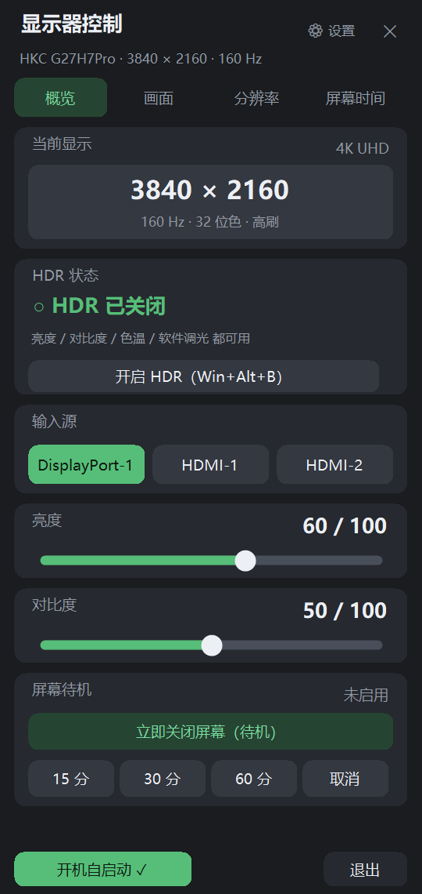
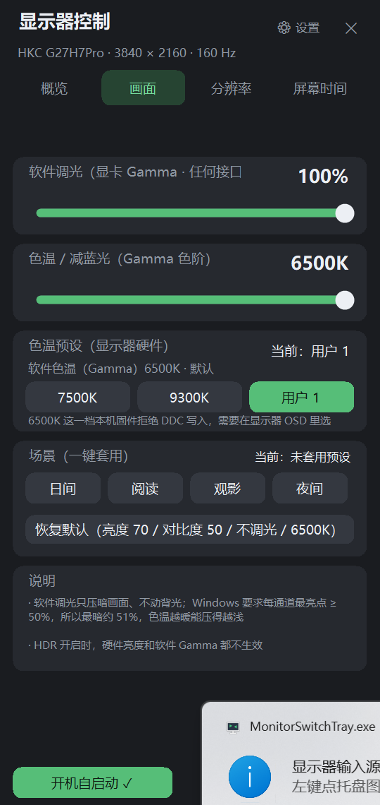
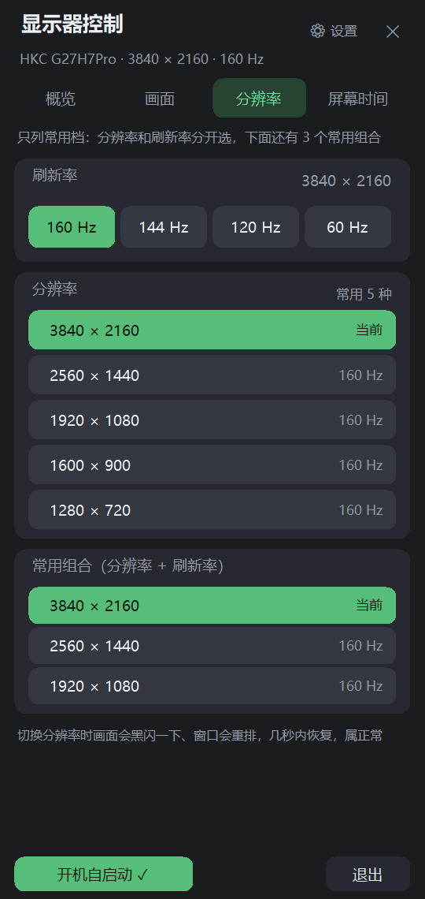
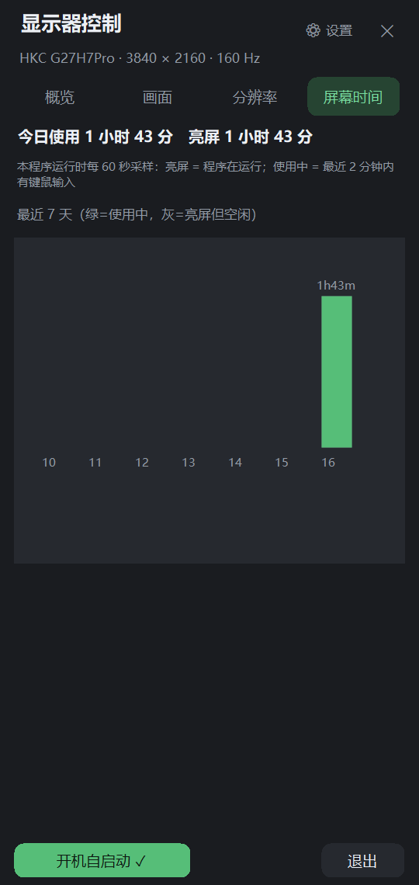

# MonitorControl

Windows 托盘 + 弹出面板的显示器控制小工具：**DDC/CI 切输入源、硬件亮度/对比度/色温，Gamma 软件调光/色温，分辨率与刷新率切换，全局快捷键**。

纯 C#（WinForms，C# 5），**不依赖任何 SDK 或第三方库** —— 用 Windows 自带的 `csc.exe` 即可编译出单个 exe。

> 参考了开源项目 [MonitorBar](https://github.com/Binaryify/MonitorBar) 的信息架构（概览 / 画面 / 分辨率 / 屏幕时间 四个分页 + 顶部状态卡），代码为本项目独立实现，并针对 HKC 显示器的固件怪癖做了大量适配与实测。

<p align="center">
  
  
  
  
</p>

## 功能

| 分页 | 内容 |
|---|---|
| **概览** | 当前分辨率与刷新率（大字卡片）、输入源切换、硬件背光亮度、对比度、**屏幕待机**（立即关屏 / 15·30·60 分钟定时关屏）、**HDR 状态卡**（HDR 开着时亮度/对比度/色温全部无效，程序会拦截并说明） |
| **画面** | 软件调光（显卡 Gamma）、软件色温/减蓝光、色温预设（显示器硬件 DDC 0x14）、场景预设（日间 / 阅读 / 观影 / 夜间）、恢复默认 |
| **分辨率** | 刷新率与分辨率**分开选**（只列常用档），另附 3 个"分辨率 + 刷新率"常用组合 |
| **屏幕时间** | 今日使用/亮屏时长 + 最近 7 天柱状图 |
| **设置** | 全局快捷键（切输入源），可逐项改键并显示是否注册成功 |

- **切换输入源、调亮度/对比度/色温** 走 DDC/CI（MCCS VCP），显示器 OSD 里的 DDC/CI 必须开着。
- **软件调光与色温** 走显卡 Gamma 表，任何接口、任何显示器都能用，不动背光。
- **全局快捷键**：显示器切到别的设备、本机画面看不见时，一个热键就能切回来（默认 `Ctrl+Shift+1/2/3`）。
- 左键点托盘图标开面板，再点一次关闭；右键是传统菜单；`Esc` 或点面板外关闭。
- **屏幕待机**：面板里一键让显示器进待机（动鼠标/按键唤醒），也可设 15/30/60 分钟后自动关屏（带倒计时，可取消）；右键菜单和命令行同样可用。
- 支持开机自启、单实例、命令行调用（见下）。
- **显示器不支持的功能不会出现在界面上**。

## 系统要求

- Windows 10 / 11（x64）
- .NET Framework 4.x（系统自带，Win10/11 无需另装）
- 显示器支持 DDC/CI（本机在 HKC G27H7Pro 上开发；其它型号多半也能用，能力以显示器上报的 MCCS 能力字符串为准）

## 安装

**方式一：下载编译好的 exe**

到 [Releases](../../releases) 下载 `MonitorControl-*.zip`，解压到任意目录，运行 `MonitorSwitchTray.exe`。
exe **未签名**，首次运行 Windows SmartScreen 可能拦一下 —— 「更多信息」→「仍要运行」即可。

**方式二：自己编译**（无需安装任何 SDK）

```
source\build_tray.cmd      → MonitorSwitchTray.exe（托盘版，主程序）
source\build.cmd           → Switch-DP1 / Switch-HDMI1 / Switch-HDMI2.exe（三个只切输入源的小工具）
```

两个脚本都用 `%WINDIR%\Microsoft.NET\Framework64\v4.0.30319\csc.exe`，路径自带、相对定位，编译产物落在仓库根目录。
**注意：源码必须保存为 UTF-8 with BOM**，否则 csc 会按 ANSI 解码字符串字面量、中文全变乱码。

## 用法

### 托盘图标

- **左键单击** → 打开面板；**再点一次** → 关闭
- **右键** → 菜单：打开面板 / 设置（快捷键）/ 刷新 / 开机自启 / 切换输入源 / 亮度 / 对比度 / 色温 / 切换 HDR / 退出
- 图标默认被 Windows 11 塞进 `^` 折叠区；程序会把自己标记为常驻（`IsPromoted=1`），若仍被折叠可从 `^` 拖出来

### 全局快捷键（默认）

| 快捷键 | 作用 |
|---|---|
| `Ctrl+Shift+1` | 回到 DisplayPort-1（本机） |
| `Ctrl+Shift+2` | 切到 HDMI-1 |
| `Ctrl+Shift+3` | 切到 HDMI-2 |

点面板右上角「⚙ 设置」可逐项改键（至少含 `Ctrl/Alt/Shift/Win` 之一，`Esc` 取消），存在 `%APPDATA%\MonitorSwitch\settings.ini`。
设置窗口底部会如实显示「已生效：…」或「这些组合被别的程序占用了：…」。

### 命令行

```
MonitorSwitchTray.exe --version               打印版本
MonitorSwitchTray.exe --panel                 打开面板
MonitorSwitchTray.exe --check                 查询当前输入源
MonitorSwitchTray.exe --switch DP1|HDMI1|HDMI2  切换输入源
MonitorSwitchTray.exe --hdr / --toggle-hdr    查询 / 切换 HDR（等于 Win+Alt+B）
MonitorSwitchTray.exe --get brightness|contrast|color|...   读 VCP
MonitorSwitchTray.exe --set brightness=70     写 VCP（自动回读确认 + 重试）
MonitorSwitchTray.exe --set-mode 2560 1440 160  切换分辨率与刷新率
MonitorSwitchTray.exe --modes                 列出所有显示模式
MonitorSwitchTray.exe --usage                 列出每日亮屏/使用时长
MonitorSwitchTray.exe --gamma-reset           把 Gamma 恢复标准曲线
MonitorSwitchTray.exe --screen-off            立即关闭屏幕（显示器进待机）
MonitorSwitchTray.exe --screen-off-in 30      30 分钟后关屏（进程驻留到关屏后退出）
```

退出码 0 = 成功，1 = 失败；输出 UTF-8，可重定向。

## 关于 DDC/CI 的几个实测坑（HKC G27H7Pro）

- **VCP `0x60`（输入源）上报的 `max` 是垃圾值（3）**。绝不能拿 `max` 去夹取目标值，否则 `0x11`(HDMI-1) 会被夹成 `3` 被忽略 —— 表现为"切输入源没反应"。enum 型 VCP 的合法值只能来自能力字符串。
- **DDC 写入不可靠**：单次 `SetVCPFeature` 既可能被忽略、也可能首次回读拿到旧值。判定成功的唯一标准是"稳定回读"，所以程序会写入后轮询、必要时重试（输入源：400ms × 最多 3 次；亮度/对比度：180ms × 最多 2 次）。
- **VCP `0x14`（色温预设）本机固件只接受 3 档**（7500K / 9300K / 用户1），写 6500K 被拒绝，写其它值会被置成"未设置"。
- **HDR 开着时 `0x10/0x12/0x14` 全部无效**：固件会把值收下并存进寄存器（回读一切正常），但完全不作用到面板，软件 Gamma 调光同样失效。HDR 状态读 `HKLM\SYSTEM\CurrentControlSet\Control\GraphicsDrivers\MonitorDataStore\<显示器>\HDREnabled`。
- **切到没信号的接口会被"自动选择输入源"弹回**（实测 HDMI-2 约 7 秒回跳，HDMI-1 观察 26 秒未回跳）。这是显示器行为，需要在 OSD 里关掉自动选源。
- **Windows 自带的亮度接口管不到外接屏**（`WmiMonitorBrightness` 枚举不到），只能走 DDC/CI。
- **Gamma 有系统下限**：每个通道最亮点必须 ≥ 32768（50%），所以单纯软件调光最暗约 51%，且色温越暖能压得越浅（暖色和深调光互相挤占）。程序触到下限时会按比例抬高三通道（保持色温比例），并在状态行如实写出实际可达成值。

更多硬件实测数据、每种 VCP 的读写结果、各轮修复记录见 **[docs/NOTES.md](docs/NOTES.md)**；面向使用者的中文离线说明见 [README.txt](README.txt)。

## 已知限制

- 只针对本机实测过的显示器行为做了适配；换显示器可能需要调整能力列表与固件怪癖处理。
- 不支持通过 DDC 调色温的连续值（固件只给 3 档）、不支持几何调整/锐度/Overdrive（不在能力字符串里，只能在 OSD 调）。
- "屏幕时间"的亮屏 = 程序运行时长，使用中 = 最近 2 分钟内有键鼠输入（推断值，非精确）。
- 单显示器（主显示器）为主，多显示器未做充分测试。

## 参考与致谢

- [MonitorBar](https://github.com/Binaryify/MonitorBar)（MIT）—— 面板式 UI 与分页信息架构的灵感来源。
- DDC/CI 通过 `dxva2.dll` 的 MCCS 接口（`GetPhysicalMonitorsFromHMONITOR` / `GetVCPFeatureAndVCPFeatureReply` / `SetVCPFeature`）实现，属用户态调用，**不需要管理员权限**。

## License

[MIT](LICENSE)
